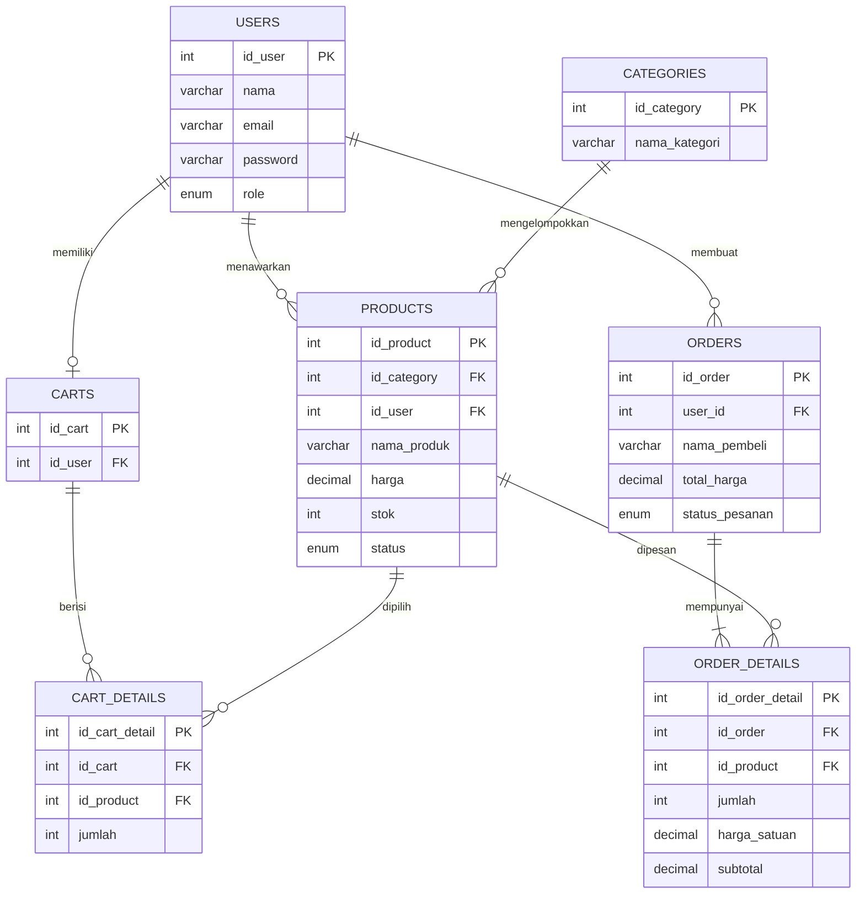

# ERD PasarKita

Catatan: checkout pada versi demo mendukung pembeli tanpa akun (guest), sehingga `orders.user_id` boleh NULL. Tabel carts dan cart_details disiapkan untuk pengembangan keranjang persisten bagi pengguna terdaftar; implementasi awal menyimpan keranjang di PHP Session.
